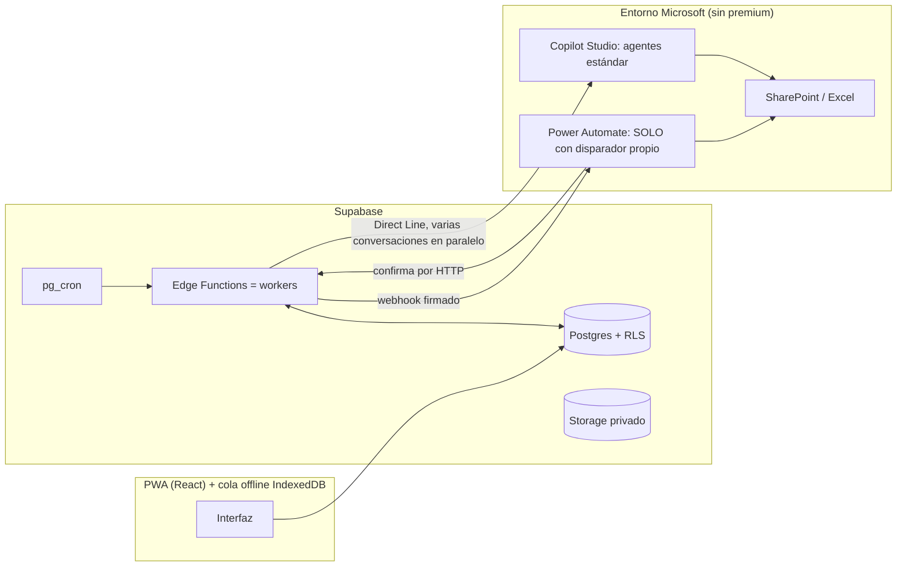
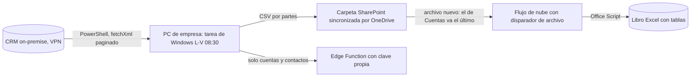

# Manual de experiencia: apps comerciales sobre Microsoft 365 + Supabase + agentes de IA

**Origen:** lecciones reales de construir PrimeNotes (app de campo para comerciales) entre septiembre y octubre de 2026.
**Para qué sirve:** ser la base de conocimiento al diseñar otras aplicaciones parecidas: qué patrones funcionaron, qué NO se puede hacer en un entorno corporativo sin licencias premium ni ayuda de TI, qué errores se cometieron y cómo evitarlos.
**Anexo A (al final):** inventario completo de SharePoint (rutas), flujos, Excel, listas, conexiones HTTP(S), herramientas de agentes y secretos, sin datos de la empresa.
**Documento hermano:** `PrimeNotes-arquitectura-para-ChatGPT.md` describe el sistema concreto (tablas, funciones, pantallas). Este documento es el **manual de lecciones y recetas**; no repite el detalle de la arquitectura.
**Seguridad:** no contiene claves, correos, URLs, identificadores de entornos/flujos/agentes ni datos de clientes.

---

## 0. Cómo leer este documento (y cómo usarlo con una IA)

Cada afirmación lleva una etiqueta de confianza:

| Etiqueta | Significado |
|---|---|
| **[MEDIDO]** | Medido o comprobado en el sistema real durante el proyecto. |
| **[DOC]** | Leído en la documentación oficial (Microsoft Learn, Supabase, Anthropic…) durante el proyecto. |
| **[NOTAS]** | Sale de las notas del proyecto de sesiones anteriores; no se ha vuelto a comprobar al escribir esto. |
| **[SIN COMPROBAR]** | Hipótesis razonable, no verificada. |

Si usas este documento para diseñar algo nuevo, pídele a la IA que **respete las etiquetas**: lo [MEDIDO] y [DOC] se puede dar por bueno; lo [NOTAS] hay que re-comprobar antes de construir encima; lo [SIN COMPROBAR] no se debe tratar como un hecho.

Prompt sugerido para empezar:
> «Lee estos dos documentos. Quiero construir <describe la app>. Con las restricciones de la sección 1 y los patrones de la sección 3, propón una arquitectura, lista qué piezas de Microsoft puedo usar sin premium, qué riesgos del apartado 7 me afectan y en qué orden construirías y probarías, por capas.»

---

## 1. Antes de empezar cualquier proyecto parecido: las preguntas que lo condicionan todo

En este proyecto, **las restricciones del entorno determinaron la arquitectura más que cualquier preferencia técnica**. Se descubrieron tarde y costaron semanas. Hazlas el primer día:

| Pregunta | Qué cambió aquí |
|---|---|
| ¿Hay licencia **premium** de Power Platform / Copilot Studio? | **No.** Impide: lanzar flujos de escritorio por programador/URL, usar flujos de nube como herramienta de un agente, la acción genérica «HTTP a SharePoint» en agentes, AI Builder (OCR). |
| ¿Se puede registrar una **aplicación en Entra ID** (app registration)? ¿Hay ayuda de TI? | **No.** Impide: Microsoft Graph con permisos de aplicación, Knowledge de SharePoint con autenticación de aplicación, cuentas de servicio. Todo corre con la **identidad delegada de una cuenta personal**. |
| ¿Dónde vive el CRM y cómo se llega? | CRM **on-premise** tras VPN, solo accesible desde un PC de la empresa. No hay API pública ni *gateway*. |
| ¿Se pueden crear tablas en **Dataverse**? | **No** (sin permiso). Se descartó como almacén. |
| ¿Los datos comerciales pueden salir del entorno Microsoft? | Decisión de la empresa: **no**. Solo cuentas y contactos del CRM se copian a la base propia; oportunidades y ofertas se quedan en el Excel de SharePoint. |
| ¿Qué cuenta es propietaria de flujos y agentes? | Una **cuenta personal**. Es un punto único de fallo asumido (si cambia de contraseña o licencia, el archivado se para en silencio). |
| ¿Qué plan de la base de datos/servidor hay? | Supabase plan gratuito al inicio: **150 s de reloj por función**, 2 s de CPU, buckets con objetos ≤ 50 MB [DOC]. |

**Lección general:** diseña pensando en «¿qué pasa si esa cuenta/PC/licencia desaparece?» y añade una pantalla de estado que avise en voz alta, porque los flujos de Power Automate **fallan en silencio**.

---

## 2. Arquitectura de referencia (el patrón que funcionó)



Principios que salieron del proyecto:

1. **La app solo habla con una base de datos propia.** Todo lo lento o externo pasa por **colas en Postgres** que procesan *workers* (Edge Functions). La app nunca espera a Microsoft.
2. **Microsoft se usa por «puertas» estrechas y deterministas**: webhook de Power Automate (para escribir en SharePoint), Direct Line (para IA) y un endpoint con clave propia (para recibir el CRM).
3. **La IA nunca decide qué hacer con datos críticos sin que el servidor controle el flujo**: el servidor pide, el agente lee/redacta, el servidor guarda.
4. **Todo es idempotente y reintentable**: cada paso se puede repetir sin duplicar efectos.
5. **Interruptores y topes en una tabla** (`ajustes_app`) para encender/apagar funciones sin desplegar.

---

## 3. Patrones reutilizables (recetas)

### P1 — Cola en Postgres + worker en Edge Function + cron + arranque inmediato
**Cuándo:** cualquier trabajo lento (IA, archivado, informes).

Esquema mínimo de la cola (genérico):
```sql
create table tarea (
  id uuid primary key default gen_random_uuid(),
  grupo_id uuid not null,                 -- p. ej. la visita/briefing al que pertenece
  fuente text not null,                   -- qué parte del trabajo es
  estado text not null default 'pendiente'
    check (estado in ('pendiente','generando','listo','vencida','error')),
  mensaje text, resultado text, error text,
  conversacion_id text, watermark text,   -- para sondear una conversación externa
  plazo_segundos int not null default 120,
  iniciado_en timestamptz, terminado_en timestamptz,
  creado_en timestamptz not null default now()
);
alter table tarea enable row level security;          -- sin políticas: solo el servidor la toca
create unique index on tarea (grupo_id, fuente);      -- evita duplicados si dos pasadas coinciden
```

Reglas del worker [MEDIDO]:
- **Reclamar antes de actuar**: `update … set estado='generando' where id=… and estado='pendiente' returning id`; si no devuelve fila, otra pasada ya la tiene.
- **Insertar de forma idempotente** (`upsert … ignoreDuplicates`) y con **todas las filas con las mismas columnas** (un `insert` con filas de distinta forma rellena con `null` y rompe restricciones).
- **Responder al cron al instante y seguir en segundo plano** (`EdgeRuntime.waitUntil`). Si la petición del cron dura 110 s, `pg_net` deja esperando las siguientes llamadas del cron [MEDIDO].
- **Sondear dentro de la ejecución** (cada ~4 s hasta ~135 s) en lugar de una pasada por minuto: una pasada por minuto añadía **hasta 60 s** a cada respuesta (las consultas bajaron de 65 s de media a ~30 s) [MEDIDO].
- **Disparo inmediato** desde la función de base de datos que encola (`net.http_post` al worker) además del cron de respaldo: sin ello la espera de arranque era de 10–57 s [MEDIDO].
- **Plazo por tarea** y degradación elegante: si una fuente no llega a tiempo, el resultado final sale sin ella y lo dice, en vez de esperar 20 minutos.
- **Registrar el error en la fila** (no solo en logs): en este entorno no siempre se tiene acceso cómodo a los logs de funciones.
- La función se despliega **sin verificación de JWT** y se autentica con una **clave en cabecera guardada en el Vault**; así el cron no necesita sesión.

### P2 — Escribir en SharePoint desde un servidor sin Entra ID: webhook de Power Automate + confirmación
**Cuándo:** subir archivos o informes a SharePoint.
1. El worker genera **URLs firmadas cortas** de cada archivo y llama al **webhook (disparador HTTP) de un flujo de nube**. El flujo de nube con disparador propio **sí funciona sin premium** [MEDIDO].
2. El flujo sube cada archivo (acción estándar «Crear archivo») y **llama a una Edge Function de confirmación** por archivo.
3. La función **compara el tamaño** subido con el original y solo entonces marca la copia como confirmada. **No se borra nada del origen en este paso.**
4. Reintentos (hasta 5 por archivo) y aviso a un responsable cuando se agotan.
- El secreto compartido va en el cuerpo del webhook (no en cabecera) si el flujo ya está construido así; documentarlo para quien audite.
- Un flujo propio **solo para copias** (copiado con «Guardar como») evita que un cambio en el flujo de visitas rompa las copias; ojo: el «Guardar como» deja el flujo **apagado y con URL de disparador nueva**.

### P3 — Archivado en dos fases (copiar y, mucho después, liberar)
**Cuándo:** el almacenamiento barato de la base se llena con fotos/audios.
- **Fase 1 (al cerrar):** copiar a SharePoint y confirmar por tamaño. El original **no se toca**.
- **Fase 2 (≥ 30 días tras cerrar y ≥ 1 día tras copiar):** borrar el original de Storage; la fila de la base **nunca se borra**, solo cambia a dónde apunta.
- **Interruptor** que mantiene la fase 2 apagada hasta que la app sepa abrir lo archivado.
- **Idempotencia con huella**: se guarda una huella del contenido al confirmar; reabrir y volver a cerrar **sin cambios** no regenera ni duplica nada en SharePoint [MEDIDO].
- Cuidado con nombres repetidos: «Crear archivo» **no sobrescribe**; hay que comparar con lo ya copiado y añadir « (2)». Los nombres con solo la hora colisionan entre días: incluir la fecha.

### P4 — Traer un CRM on-premise a Microsoft 365 sin licencia premium

Decisiones y por qué [NOTAS salvo indicación]:
- **Power Automate Desktop gratuito no permite lanzar flujos por programador ni por URL** (requiere premium) → se sustituyó por una **tarea programada de Windows** que ejecuta el mismo PowerShell. «Si el PC estaba apagado, ejecutar al encender.»
- **CSV como «conocimiento» del agente falló**: búsqueda por fragmentos, listas distintas en cada conversación (3, 2, 9 cuentas) y **ids inventados** (GUID que no existían en ningún CSV) [NOTAS]. Se pasó a **tablas de Excel + herramienta «Enumerar filas» con filtro por id** [MEDIDO: respuestas de 5–7 s].
- **Bug clásico de la API web de Dynamics:** los campos de relación (*lookups*) se devuelven como `_campo_value`, no como `campo`; si el script copia `campo`, la columna sale **vacía en todas las filas** [NOTAS]. Comprobar siempre que las columnas clave no estén vacías.
- El conector de Excel **no admite filtros OData sobre columnas que empiezan por `_`**: el Office Script las renombra quitando el guion bajo inicial, y guarda **todo como texto** (ids y números con ceros no se transforman).
- El flujo **no garantiza el orden de las partes** → el Office Script lleva una hoja oculta `_control` con la hora de la última parte de cada tabla: si pasó más de la ventana (10 min) es una carga nueva (borra y rehace la hoja); si no, añade filas. Relanzar dentro de la ventana duplicaría filas.
- «Obtener archivos» devolvía **vacío en una biblioteca de más de 5.000 elementos**; hubo que usar «Mostrar lista de carpetas» [NOTAS].
- Tamaño de referencia: tablas de **miles de filas** (la mayor, decenas de miles); suficiente para que un filtro por id sea la única forma viable de leer.
- Carga **una vez al día** es suficiente (se descartaron cargas a las 7:00 y 11:00).
- **Riesgo abierto:** depende de un PC encendido y con VPN y no hay aviso si no se carga.

### P5 — Agentes de IA: lector acotado + redactor sin herramientas, orquestados por el servidor
**Cuándo:** generar un informe/briefing con datos de varias fuentes.

1. **Lectores:** un agente de **motor estándar** con herramientas acotadas (Excel «Enumerar filas», SharePoint «Mostrar lista de carpetas» y «Obtener contenido de archivo por ruta», Jira, Confluence). El servidor abre **una conversación por fuente, en paralelo**, con un mensaje que pide *«solo filas separadas por ` | ` y acabar con la línea `FIN-LECTURA`»* [MEDIDO].
2. **Datos propios por SQL** (0 s): lo que ya consta en la app (visitas, pendientes, contactos).
3. **Redactor:** un segundo agente **sin herramientas** y con un modelo de categoría «General» (rápido). Recibe **instrucciones + datos en un único mensaje** (Direct Line admite hasta 256K caracteres [DOC]); sus instrucciones propias son mínimas para que no choquen.
4. El servidor **junta, limpia y guarda**. Salvaguardas en código: quitar marcas internas, forzar 2 decimales en importes.
5. **Medidas reales** [MEDIDO]: briefing completo **361 s → 58–79 s** (con caché) / **96–116 s** (en frío); redacción 10–20 s; lecturas 19–73 s según la fuente.

Reglas de oro del prompt (todas salieron de fallos reales):
- «Usa SOLO los datos del mensaje.» «Relaciona registros solo por id exacto.»
- **Prohibido sumar o calcular totales/medias:** el modelo escribió un total distinto y erróneo en cada ejecución [MEDIDO].
- **«Cada dato aparece una sola vez»** y un **límite en viñetas/frases** (no en palabras; los LLM cuentan tokens, no palabras [DOC]). Con tres redactores en paralelo sin verse, las mismas ideas salían en 5–6 secciones; con **un** redactor rápido el problema desaparece.
- Pedir **objetivo de la visita con reglas de prioridad** («elige el primero de estos casos que se cumpla») en vez de «sugiere un objetivo».
- Nunca imprimir marcas internas («SIN REGISTROS», «NO DISPONIBLE») en el texto final.

### P6 — Interruptores, topes y despliegue seguro de funciones nuevas
- Una tabla `ajustes_app(clave, valor boolean, valor_numero)` legible por todos y escribible solo por Dirección.
- **Toda función nueva nace apagada** (`briefing_rapido_activo=false`), se prueba en real con el interruptor encendido, y se vuelve a apagar hasta que una persona apruebe la **calidad**. Con la base compartida entre pruebas y producción, el interruptor es la red de seguridad.
- Topes de consumo de IA por día y usuario; bloqueo de regeneración (1 h).

### P7 — Offline en el móvil (PWA)
- Una sola base IndexedDB con **una cola** de operaciones; se sincroniza **en orden de creación respetando dependencias** (cliente → proyecto → visita → capturas), con reintento con retroceso (3, 6, 12, 24, 30 s; 5 intentos) [MEDIDO].
- **Binarios como `ArrayBuffer`, no `Blob`**: Safari de iOS invalida los `Blob` grandes de IndexedDB al reescribir el registro (fotos con icono roto «?» durante ~1,5 s) [MEDIDO].
- **Errores de servidor por tamaño o formato (413/415) no se reintentan**: van a «error» con mensaje en español; la red, la cuota y la sesión sí se reintentan.
- Conflictos: «último gana», porque lo capturado es casi todo de solo añadir.
- **Fecha y GPS de una foto subida de la galería** salen de su EXIF, leído **antes de comprimir** (el canvas lo borra); nunca la posición actual.

### P8 — Copias de seguridad de las tablas a SharePoint (cifradas) con rotación
- JSON de las tablas (sin las que se recargan del CRM) generado **en el servidor** (el navegador solo traía lo que veía quien pulsaba), **cifrado antes de salir** (AES-GCM + RSA-OAEP: en el servidor solo hay la clave **pública**), subido a un bucket temporal (se borra a las 2 h) y enviado por el webhook a una carpeta fija.
- Cron diario que **solo actúa si no hay una copia confirmada de menos de 7 días**; si el flujo falla, reintenta al día siguiente.
- **Rotación en otro flujo** programado semanal que conserva las 8 más recientes **por nombre** (cuenta copias, no días: si dejan de llegar, no borra nada). Lo borrado va a la papelera de SharePoint (~93 días).
- **Restauración real: no probada** (solo el formato, cargado en un esquema temporal con los mismos recuentos). Pendiente.

### P9 — Informes: PDF, HTML autocontenido y mapa
- **PDF con `pdfmake`** en Edge Functions (Deno). `@react-pdf/renderer` **no arranca** en Deno (depende de APIs de Node) [MEDIDO].
- **Informe web = un único `.html`** con fotos embebidas, buscador, menú por tipo/zona y mapa **Leaflet**. Las páginas `blob:`/descargadas no mandan `Referer` → OpenStreetMap devuelve una imagen de «acceso bloqueado»: se resuelve con un **proxy de teselas** en una Edge Function pública con User-Agent y Referer correctos [MEDIDO].
- Objetos de más de 50 MB no caben en un bucket: **ZIP en trozos de ~40 MB**.
- Móvil: el informe de 7.500 px seguidos y el buscador escribiendo en el menú «parecían rotos»; en pantallas ≤ 900 px zonas plegables y buscador propio.

### P10 — Altas de usuarios sin contraseñas en claro
- Una única función con clave de servicio (`crear`, `editar`, `desactivar`, `enlace_acceso`): crea el usuario en Auth con el **mismo uuid** que la tabla de negocio y devuelve un **enlace de un solo uso** (`recovery`) con el que la persona elige su contraseña.
- **Baja:** sin historial se borra del todo (también la cuenta de Auth); con historial se conserva y su correo se reescribe a uno inválido guardando el original; se cierran sus sesiones y la app lo saca al login.
- Un enlace de acceso **se gasta al usarlo**: no pegarlo en un chat.

---

## 4. Guía de Copilot Studio para agentes que se llaman desde código

### 4.1 Elegir el motor (lo que más pesa en la velocidad)
| | **Estándar** (clásico) | **«GitHub Copilot»** (editor nuevo) |
|---|---|---|
| Cómo razona | Sigue las reglas, herramientas y temas que defines | Razona paso a paso, explora y reintenta solo |
| Latencia en tareas acotadas | Baja: consulta con lectura **17–30 s** [MEDIDO] | Alta: briefing completo **300–360 s** [MEDIDO] |
| Créditos | Modelo de licencia estándar | Consume créditos de Copilot [DOC] |
| Cuándo | Tareas **acotadas y repetibles**: leer fuentes conocidas, redactar | Trabajo largo, abierto, con archivos o varios agentes [DOC] |
- No consta en la documentación que un agente se **convierta** de un motor a otro: se rehace [DOC].
- Medido: en el motor «GitHub Copilot» el agente hizo **~12 llamadas de exploración** (listar sitios, listar raíces, 404 contra un sitio que se inventó…) antes de leer el CRM, aunque sitio, biblioteca y archivo estaban fijados [MEDIDO].

### 4.2 Crear un agente estándar (pasos reales)
1. Inicio › *Otras formas de crear* › **Agente Estándar** › nombre › Crear.
2. Configuración › IA generativa › **Orquestación = Sí** (si no, contesta «no sé muy bien cómo ayudarle»).
3. Página *Información general*: modelo e instrucciones (≤ 8.000 caracteres; **cuanto más cortas, mejor** [DOC]).
4. **Autenticación = «Sin autenticación»** y «Requerir acceso protegido» (secreto de Direct Line). Un agente nuevo viene con «Autenticar con Microsoft», que Direct Line **no admite** (`IntegratedAuthenticationNotSupportedInChannel`) [MEDIDO]. Cambiarlo cuenta como rebajar seguridad: lo hace una persona, no una IA.
5. **Publicar** (botón arriba a la derecha, junto a «Configuración» y «Probar») y, en Seguridad › Seguridad del canal web, copiar el secreto. El secreto se guarda como **secreto de las Edge Functions**; nunca en el chat ni en el repo.
6. Apuntar en el repo: modelo, herramientas, instrucciones (copia versionada), fecha y qué cambió.

### 4.3 Herramientas
- La **descripción** de cada herramienta decide cuándo se usa: en español, qué devuelve y cómo llamarla [DOC].
- Entradas: por defecto «Rellenar con IA». **Lo que no cambia (sitio, biblioteca, archivo, instancia) → «Valor personalizado»**. Si se deja a la IA, el agente **pregunta al usuario y por Direct Line se queda colgado** [MEDIDO]. En Excel «Enumerar filas» fijar además *Order By* y *Top Count*.
- **Credenciales: «proporcionadas por el fabricante»**; si no, pide consentimiento en cada llamada y por Direct Line se bloquea.
- Hasta 128 herramientas, **recomendado 25–30** [DOC]. Varias herramientas elegidas en un turno se llaman **en secuencia**, no en paralelo [DOC]: el paralelismo se consigue con **varias conversaciones desde el servidor**.
- **Una herramienta rota contamina el turno entero**: un flujo bloqueado hizo fallar también al conector de Excel en el mismo turno (3 de 3 veces). Desactivar lo que no funcione [MEDIDO].
- Jira: el conector devuelve los incidentes **completos**; una consulta amplia agota el contexto (`ContextTokenLimitExceeded`). La palanca real es un **JQL acotado** (por cliente y fecha reciente) [MEDIDO].
- Documentos: «Obtener contenido de archivo mediante ruta» **extrae texto directamente** de PDF, Word y Excel (sin conversión ni OCR) [MEDIDO]. No lee zip/rar/7z ni presentaciones de imágenes: en ese caso el agente da un **enlace** (sitio + `/` + ruta con espacios como `%20`) [MEDIDO]. Existe una acción hermana «Obtener contenido de archivo» (sin «por ruta») que pide un selector y **no admite relleno dinámico**: no usarla.
- **Navegar carpetas no es buscar**: «Mostrar lista de carpetas» solo navega por nombre. Con un centenar largo de carpetas en la raíz y decenas de miles de documentos por debajo, el agente a veces se rendía tras mirar solo la raíz o solo una categoría. Mitigación: dar el **mapa de categorías** en las instrucciones, comprobar **todas** las categorías con el cliente ya fijado y decir qué categorías se comprobaron [MEDIDO].

### 4.4 Velocidad: dónde se va el tiempo
- Cada vuelta del modelo entre herramientas cuesta **10–20 s**; las herramientas en sí 0,3–7 s [MEDIDO]. Menos vueltas = más rápido.
- El tiempo de generación es proporcional a los **tokens de salida**; la entrada casi no cuenta (≈54 car./s con entradas de 6 K, 10 K y 17 K) [MEDIDO].
- Modelos por categoría [DOC]: **General** = latencia mínima; **Auto** = variable; **Deep** = la más alta. Para resumir/redactar, General. Comparación de panel con los mismos hechos: GPT-5.5 Chat ≈ 15 s, Claude Sonnet 4.6 ≈ 76 s (calidad **sin comparar**) [MEDIDO].
- Reducir la **salida**: límites de viñetas/frases y menos secciones. Trocear la redacción en partes en paralelo funciona (3 partes de 9–14 s) pero **empeora la coherencia**: con un modelo rápido, mejor un solo redactor.
- **Partir una lectura lenta en dos lectores en paralelo empeoró** (73 s y 94 s frente a 73 s del único) [MEDIDO]: el cuello de botella eran las llamadas encadenadas, no el volumen. Lo que funcionó: **caché por cuenta con caducidad**.
- **Recortar columnas/filas de una lectura acelera** (ofertas de 71 s a 40–59 s al limitar a 25 filas y 8 columnas), pero **cuidado de no quitar la columna clave**: al recortar se perdió la referencia de la oferta y el briefing dejó de citarla; lo detectó una comprobación automática [MEDIDO].

### 4.5 Cuotas y límites [DOC]
- Las cuotas son **por entorno**, no por agente: 50–100 mensajes generativos/min (1.000–2.000/h) según plan. **Un agente por usuario no multiplica capacidad** (idea descartada).
- Panel «Probar»: mensaje máx. **2.000 caracteres**; Direct Line admite 256 K (recomendado < 150 K).
- Instrucciones: 8.000 caracteres. Un agente **sin herramientas ni conocimiento NO contesta** («No se encontró información») salvo que se active *Configuración › IA generativa › «Permitir respuestas sin fundamentación»* [DOC + MEDIDO].

### 4.6 Direct Line desde un servidor
- Usar el **endpoint regional** (el de Europa); el global dio 403 con un agente europeo [MEDIDO].
- Abrir conversación → enviar actividad → leer `GET activities?watermark=`. **Con `watermark` solo devuelve actividades nuevas: acumular el texto entre sondeos** [MEDIDO].
- `turn.complete` **no siempre llega**: pedir una marca final explícita al agente (`FIN-LECTURA`) y/o aceptar un patrón («Fuente:»). Detectar también errores del propio agente («Código de error:») y fallar al instante [MEDIDO].
- Cada petición = conversación nueva; sin estado compartido entre conversaciones.

### 4.7 Instrucciones: higiene
- Quitar **reglas heredadas** que bloquean lo que ahora sí funciona (había una «no leas documentos» de cuando no se podía y el agente se negaba a leer aunque la herramienta ya funcionaba) [MEDIDO].
- Incluir «**nunca dejes el turno sin cerrar**» y un **presupuesto de llamadas** por pregunta (aquí, 6); sin ello había preguntas que se colgaban 8 minutos [MEDIDO].
- Una instrucción de formato **debe poder ser superada por la petición del servidor** («si la pregunta pide un formato concreto, ese manda»); si no, el agente añade «Fuente:» y comentarios a una lectura que debía ser solo filas.
- Texto corrupto o duplicado en instrucciones largas pasa desapercibido: versionarlas en el repo y comparar con lo publicado.

---

## 5. Power Automate, SharePoint, Excel y Office Scripts: lo que funciona y las trampas

| Tema | Hecho |
|---|---|
| Flujo de nube con **disparador propio** (HTTP, archivo, recurrencia) | **Funciona sin premium** [MEDIDO]. |
| Flujo de nube **como herramienta de un agente** | **No** (premium): `AuthenticationNotConfigured` [MEDIDO]. |
| Power Automate **Desktop** gratis | No se lanza por programador ni por URL; usar tarea de Windows [NOTAS]. |
| «Crear archivo» de SharePoint | **No sobrescribe**; prever nombres repetidos. |
| Archivos `application/json` | Power Automate añade **3 bytes (BOM)**: subir como `application/octet-stream` [MEDIDO]. |
| «Delete file» → *File Identifier* | Es un **selector**: una expresión escrita queda como **texto literal** → `NotFound`. Solo vale contenido dinámico [MEDIDO]. |
| Bucle `skip(...)` con «Identificador» dentro | Crea un `For each` interior sobre **toda** la lista y **borra todo**; se rehace con `createArray(items('Apply_to_each'))` [MEDIDO]. Con la papelera de SharePoint no se perdió nada. |
| «Save As» de un flujo | Lo deja **apagado** y con **URL de disparador nueva** (la URL lleva una firma = secreto). |
| Disparador *Week* del diálogo de creación | Se guardó como *Minute* (ejecución cada minuto): **revisar siempre el disparador**. |
| Flujo programado apagado | No se puede ejecutar ni probar. |
| «Get files (properties only)» | 100 por defecto, hasta 5.000; en bibliotecas enormes puede devolver vacío [DOC + NOTAS]. |
| Office Script en Excel web | Sirve para volcar CSV en tablas; sin garantía de orden de partes (ver P4). |
| Conectores no Microsoft con OAuth delegado (Jira) dentro de un flujo-herramienta | Fallaba con `AuthenticationNotConfigured` aunque el flujo funcionara por sí solo [MEDIDO]; se resolvió con el **conector directo** del agente. |
| Automatizar el **diseñador** de Power Automate con un navegador controlado por IA | **Muy costoso** y frágil (se agotó la ventana de uso); mejor guiar a la persona paso a paso o buscar una vía más directa [NOTAS]. |
| Accesos directos de OneDrive creados por DOM/REST desde el navegador | Fallan (enlazan la carpeta vecina): hacerlos a mano. |
| Propiedad de flujos y agentes | Una sola cuenta; sin copropietario (decisión del dueño). |

**Regla de oro del equipo (escrita tras un incidente):** antes de construir o ejecutar un flujo que **borra**, leer la documentación de cada acción y los problemas conocidos del diseñador, y probarlo **por capas**: 1) solo listar; 2) borrar con datos de prueba y un número pequeño; 3) el valor real. Un flujo de borrado se construyó una vez de memoria y borró dos copias reales por el bucle erróneo.

---

## 6. Qué NO se pudo hacer (y qué se hizo en su lugar)

| Intento | Resultado | Alternativa que funcionó |
|---|---|---|
| Flujo de Power Automate clásico como herramienta de agente | `AuthenticationNotConfigured` (premium) | Conectores directos acotados |
| «Agent Flow» nativo para esquivar el bloqueo | Funcionó en una prueba, pero **crear uno nuevo redirigía a un entorno inaccesible** (error de plataforma) [NOTAS] | Conectores directos |
| Acción genérica «Enviar solicitud HTTP a SharePoint» como herramienta | Mismo bloqueo; el conector estándar **no tiene acción de búsqueda** | Navegar carpetas + cadena de herramientas |
| Knowledge de SharePoint (RAG nativo) por cliente | Exige autenticación de Entra del agente; límite de 1.000 archivos por fuente [DOC]; no se puede sin TI | «Mostrar lista de carpetas» + «Obtener contenido por ruta» |
| CSV como conocimiento del agente | Listas distintas y **ids inventados** | Excel con tablas + filtro por id |
| Dataverse como almacén del CRM | Sin permiso para crear tablas | Excel en SharePoint |
| OCR con AI Builder para leer PDF | Funciona pero es premium y innecesario | El conector ya extrae texto |
| `@react-pdf/renderer` en Deno | No arranca | `pdfmake` |
| Teselas OSM desde una página descargada | Bloqueadas | Proxy en Edge Function |
| Pedir al agente que sume importes | Inventa | Prohibido en el prompt; solo cifras presentes en datos |
| Un agente por usuario para evitar cola | No aumenta cuota | Paralelismo desde el servidor |
| Sondeo largo dentro de la petición del cron | Bloquea las llamadas siguientes | `waitUntil` + sondeo en segundo plano |
| Partir un lector lento en dos | Más lento | Caché con caducidad |
| Autoinforme del agente («responde solo la lista de herramientas») para medir | Lo trató como **inyección** y no lo hizo | Medir por la cola real (columnas de inicio/fin) |
| Jira REST directo con token | `/rest/api/3/search` está descontinuado (410): usar `/search/jql`; además la cuenta del token no veía incidencias (permiso «Browse projects») [NOTAS, no confirmado si se resolvió] | Conector de Jira del agente |
| Restaurar copia de seguridad | Solo probado el formato | Pendiente |

---

## 7. Cronología de decisiones (por qué es como es)

1. **Briefing con Jira directo y sin IA** (13 sept) → la cuenta del token no veía ninguna incidencia (permisos) y el endpoint estaba descontinuado [NOTAS]. Se abandonó.
2. **Briefing con un agente de Copilot Studio** (25–26 sept): primero con CSV como conocimiento (se inventaban ids, ~110–150 s solo para resolver la cuenta) → **Excel + herramienta** → primer briefing correcto por la app: **6,0 min** [NOTAS].
3. **Carga del CRM**: 4 flujos de escritorio → tarea de Windows en PowerShell (sin premium) → flujo de nube + Office Script → Excel.
4. **Briefing asíncrono** (cola + worker + cron) con tiempo estimado y transcurrido, y **briefing nocturno** de las visitas del día siguiente.
5. **«Pregunta a la IA»** (agente de consultas, motor estándar, 6 llamadas máx.). Se descubrió el bloqueo premium de los flujos-herramienta y se montó la cadena «listar carpetas → obtener contenido por ruta».
6. **Archivado a SharePoint** diseñado como «cliente primero» y por webhook (no hay Entra ID); luego en **dos fases** (copiar al cerrar / liberar a los 30 días) con huella para no duplicar; informes PDF y web; copia de seguridad cifrada con rotación.
7. **Optimización del briefing (9 oct)**: 361 s → **58–116 s**. Palancas por orden de impacto: (a) sondeo dentro del worker y arranque inmediato (−hasta 60 s en todo), (b) abandonar el motor «GitHub Copilot» para esta tarea, (c) lecturas en paralelo desde el servidor, (d) redactor sin herramientas con modelo rápido, (e) recortar columnas y filas, (f) caché de la lectura más lenta, (g) menos tokens de salida.
8. **Rediseño del contenido para el comercial** (9–10 oct): de 6.600 caracteres repetitivos a ~2.800 con objetivo, preguntas, dinero abierto, última visita y pendientes; **un solo redactor**.

Tabla de tiempos del briefing [MEDIDO, cliente de prueba]:

| Versión | Total |
|---|---|
| Agente único, motor GitHub Copilot | 304–361 s |
| + sondeo en worker | 361 s (el agente seguía en 304 s) |
| Lecturas en paralelo + 1 redactor (agente de consultas) | 261 s |
| + 3 redactores en paralelo | 222 s |
| + prompt corto | 188 s |
| + Redactor dedicado (modelo rápido) | 101–117 s |
| + lecturas recortadas y caché de Licitaciones | **58–79 s** (caché) / **96–116 s** (frío) |

---

## 8. Errores cometidos y cómo se evitan (lecciones de proceso)

| Error | Consecuencia | Regla que lo evita |
|---|---|---|
| Construir un flujo de borrado **de memoria**, sin leer la documentación | Borró dos copias reales (recuperables por la papelera) | Documentación → capa segura → clic; anotar qué se leyó y qué **no** está documentado |
| Afirmar «ya está» sin mirar el resultado real | Pérdida de confianza | «Hecho» = he visto el resultado después; las notas no son hechos |
| Medir tiempos **cronometrando la interfaz** (sesión sin reiniciar, texto viejo en pantalla) | Mediciones falsas | Medir por columnas de inicio/fin de la cola real |
| Añadir una clave foránea nueva y no probar el worker | El worker dejó de ver los pendientes ~20 min (afectaba también al camino antiguo): consulta ambigua de PostgREST | Tras cada migración, probar el worker; usar el nombre de la FK en los *embeds* |
| Recortar columnas para ganar velocidad | El briefing dejó de citar las referencias de oferta | Comprobación automática de fidelidad tras **cada** cambio de prompt o columnas |
| Insert con filas de forma distinta | Violación de `not null` por columnas rellenadas con `null` | Mismas columnas en todas las filas |
| Dos pasadas del worker a la vez | Tareas duplicadas | Índice único + inserción idempotente |
| Dejar que el modelo calculara totales | Cifras distintas y erróneas | Prohibirlo en el prompt y limpiar en código |
| Mezclar instrucciones propias del agente con las del mensaje | El agente seguía el formato antiguo | Instrucciones mínimas en el agente; las reales viajan en el mensaje y se versionan |
| Dar por buena una función sin que una persona lea la salida | Riesgo de enviar texto malo | Interruptor apagado hasta que alguien apruebe la **calidad** |
| Mostrar datos de clientes reales al verificar | Incumple la regla de privacidad | Verificar con SQL de recuentos y un cliente de prueba |
| Hacer capturas de pantalla para ubicar clics | Se ven en la pantalla del dueño | Prohibido; usar texto/DOM/SQL |

**Comprobación automática de fidelidad (receta, SQL):** tras generar un briefing de prueba, comprobar que (1) cada referencia y cada importe citados existen en los datos de entrada, (2) no hay identificadores internos ni marcas, (3) la referencia del objetivo está en «Dinero abierto», (4) cada dato aparece una vez (contando apariciones), (5) el nº de secciones es el esperado.

---

## 9. Método de trabajo con un asistente de IA que programa (reglas que funcionaron)

- **Ramas y producción**: nunca trabajar en la rama principal; todo en `feature/*` con Pull Request y vista previa; **publicar en producción solo con una frase literal** escrita por el dueño (en este proyecto, empujar a `main` publica automáticamente).
- **Cambios mínimos**; arreglar la **clase** de bug en toda la app, no solo el caso reportado.
- **Documentar en el repo en el mismo momento** todo lo que se cree fuera (flujos, agentes, carpetas, secretos —solo su nombre—, crons).
- **Secretos**: la IA **no escribe** contraseñas, claves ni tokens en ningún campo ni los ve; los guarda la persona en la terminal con lectura oculta o en la interfaz del servicio. Cualquier **rebaja de seguridad** (p. ej. cambiar la autenticación de un agente) la hace la persona.
- **Borrados masivos de Storage o de SharePoint** los lanza la persona (la IA da el comando).
- **Datos de prueba** con prefijo reconocible y **se borran al terminar**; la base es la misma que producción.
- **Respuestas del asistente**: solo resultado, sin explicaciones no pedidas ni narración; sin capturas.
- **Lectura previa del grafo del código** (`graphify`) antes de buscar en archivos.

---

## 10. Seguridad y privacidad: patrones

- **RLS en todas las tablas**; funciones auxiliares (`rol_actual`, `es_participante`, `es_responsable`) alimentan las políticas. Acciones sensibles = funciones `SECURITY DEFINER` con comprobación interna.
- **Buckets privados** y **URLs firmadas cortas**. Informes temporales en un bucket que se limpia a las 2 h.
- **Cola solo para el servidor**: RLS activada y **sin políticas** (el servicio las salta).
- **Funciones sin JWT** (cron/webhook/CRM) con **clave propia en cabecera** validada contra el Vault; la clave del PC del CRM solo sirve para subir cuentas y se rota sin tocar nada más.
- **Copias cifradas** antes de salir; clave privada fuera del servidor.
- **Datos de clientes que no salen del entorno Microsoft/Supabase**; consumo de IA registrado y con topes; quién pregunta queda anotado.
- **No mostrar datos de clientes en logs ni respuestas de verificación.**
- Un invitado «pendiente» a una visita **no ve ni sube nada** (probado).

---

## 11. Checklist para empezar otra app con esta experiencia

1. Responder las preguntas de la sección 1 y escribir las restricciones en el repo.
2. Elegir qué se queda en la base propia y qué en Microsoft; **no copiar datos sensibles de más**.
3. Modelo de datos con **RLS desde el principio** y un rol de «dirección» con permisos amplios.
4. Cola(s) + worker(s) con el patrón P1 **antes** de integrar nada lento. Interruptores y topes desde el día 1.
5. Si hay que escribir en SharePoint: patrón P2 con confirmación por tamaño y reintentos; pantalla de estado.
6. Si hay IA: lectores acotados en motor estándar + redactor sin herramientas con modelo rápido (P5); medir por la cola; comprobación de fidelidad automática.
7. Si hay datos de un CRM on-premise: P4 (tarea programada + CSV + flujo con disparador + Excel); comprobar que **ninguna columna clave llega vacía**; avisar si la carga lleva días sin ejecutarse.
8. PWA offline con cola en IndexedDB (binarios como `ArrayBuffer`).
9. Informes: HTML autocontenido + PDF; proxy de mapas.
10. Probar **por capas** y con un cliente de prueba; borrar los datos de prueba.
11. Antes de publicar: interruptor apagado, una persona aprueba la calidad, y se documenta cómo apagarlo.
12. **Pantallas de salud** para Dirección: archivado atascado, copias sin hacer, briefings con error, carga del CRM antigua.

---

## 12. Glosario breve

- **Direct Line**: API REST de Microsoft para hablar con un agente de Copilot Studio desde código.
- **Motor estándar / «GitHub Copilot»**: dos tiempos de ejecución de agentes en Copilot Studio (ver 4.1).
- **Herramienta (de un agente)**: acción de un conector (Excel, SharePoint, Jira…) que el agente puede llamar.
- **Webhook de Power Automate**: disparador HTTP de un flujo de nube.
- **Office Script**: script de Excel web que un flujo puede ejecutar.
- **Worker**: Edge Function que procesa una cola.
- **RLS**: seguridad a nivel de fila de Postgres.
- **Vault**: almacén de secretos de Supabase accesible desde SQL.
- **Huella (huella de contenido)**: resumen del contenido para saber si algo cambió y evitar duplicar.
- **Caché con caducidad**: tabla que guarda una lectura lenta por cuenta durante N horas.

---

## 13. Lo que queda abierto (no dar por resuelto)

1. Calidad del briefing rápido pendiente de **aprobación humana**; sigue apagado en producción.
2. **Incidencias abiertas «que queman» y desarrollos sin entregar** no aparecen: Jira se consulta solo por «actualizadas en 90 días» con 4 campos; falta leer abiertas sin límite de fecha (prioridad, tipo, responsable, antigüedad) y decidir cómo se marca en Jira un desarrollo pendiente.
3. **Restauración real** de una copia de seguridad sin probar; segunda copia de la clave privada; permisos de la carpeta de copias.
4. **Aviso cuando el CRM no se carga** (depende de un PC con VPN) y «datos del CRM al <fecha>» en el briefing.
5. **Segundo propietario / cuenta de servicio** para flujos y agentes.
6. Cuánto cuesta en **cuota generativa** una conversación y qué pasa con muchos comerciales a la vez [SIN COMPROBAR].
7. Probar en un **iPhone físico** (se probó en simulador y escritorio).
8. La app **no borra nada en SharePoint** al borrar una visita o cliente (decisión pendiente).

---

## 14. Preguntas útiles para hacerle a la IA con este documento

- «Dame los puntos únicos de fallo de esta arquitectura y cómo reducirlos sin premium ni Entra ID.»
- «Diseña la cola, el worker y la tabla de interruptores para <mi nuevo proceso lento> siguiendo P1.»
- «Propón una batería de pruebas por capas y una comprobación de fidelidad para <mi agente>.»
- «Dado este caso de uso, ¿qué parte iría a un agente estándar y cuál a SQL/servidor? Justifica con las medidas del documento.»
- «Revisa mi plan contra la tabla de la sección 6 y dime qué intento ya sabemos que fallará.»

---

# ANEXO A — Inventario de las piezas Microsoft y de todas las conexiones HTTP(S)

> **Sin datos de la empresa.** Los nombres de sitios, bibliotecas, dominios, ids, correos, hosts del CRM e instancias de Jira se sustituyen por marcadores (`<sitio-comercial>`, `<tenant>`, `<instancia-jira>`…). La **estructura** (qué hay, dónde, con qué forma de nombre, qué se envía y qué se responde) está completa para poder replicarla.
> Etiquetas de confianza como en la sección 0. Donde algo **no está anotado en el repo** se dice (el proyecto exige anotar todo lo que se crea fuera; esos huecos son deuda).

## A1. Mapa de ubicaciones en SharePoint

Hay **dos sitios** de SharePoint implicados:

| Marcador | Para qué | Quién escribe | Quién lee |
|---|---|---|---|
| `<sitio-comercial>` (sitio del departamento comercial) | Todo lo de PrimeNotes: archivos de visitas, informes, copias, CRM en Excel | Flujos de Power Automate (con la cuenta propietaria) y la tarea de Windows del CRM (vía OneDrive) | Personas con acceso al sitio; agentes (solo el Excel del CRM) |
| `<sitio-proyectos>` (sitio de seguimiento de proyectos) | Carpetas de licitaciones y pedidos de la empresa (**ya existían**; PrimeNotes no escribe) | Nadie desde PrimeNotes | Agentes: solo **lectura** (listar carpetas y leer documentos) |

Árbol dentro de `<sitio-comercial>` › biblioteca **Documentos** (`/Shared Documents/…`) [DOC + MEDIDO]:

```
General/
└─ PrimeNotes/
   ├─ PrimeNotes - CRM/                      ← CSV por partes + libro Excel de lectura
   │    ├─ <Prefijo>_Accounts_1.csv            (el de cuentas se sube el último y dispara el flujo)
   │    ├─ <Prefijo>_Contacts_1.csv
   │    ├─ <Prefijo>_Opportunities_1..N.csv
   │    ├─ <Prefijo>_Quotes_1..N.csv
   │    └─ PrimeNotes_CRM.xlsx                 ← hojas Cuentas / Contactos / Oportunidades / Ofertas
   │                                              + hoja oculta _control (ventana de carga)
   ├─ PrimeNotes - Comerciales/               ← archivo de visitas (carpeta raíz creada a mano, existía antes)
   │    └─ <cliente>/<proyecto>/<AAAA-MM-DD Visita>/
   │         ├─ Foto HH-MM-SS.jpg  · Audio HH-MM-SS.m4a  · <nombre original del documento>
   │         └─ Informe de la visita (cerrada AAAA-MM-DD HH-MM).pdf / .html
   └─ Copias de seguridad/
        └─ Base de datos/Últimas copias/
             └─ primenotes-copia-AAAA-MM-DD-HHMM.json(.enc)
```

> Nota de historia: las copias de seguridad estuvieron primero bajo la carpeta de comerciales y **se movieron a una carpeta propia** porque heredaban permisos amplios y el JSON trae datos de todos los clientes. Tras el cambio hubo que romper la herencia de permisos de «Copias de seguridad» (solo Dirección/TI); esa tarea manual **sigue pendiente** [NOTAS].

**Cómo se forman los nombres de carpeta** (función SQL `fn_carpetas_archivado`, comprobada leyendo su definición):
- **Cliente** y **proyecto**: el nombre limpiado de caracteres no admitidos por SharePoint (`\ / : * ? " < > | # % ~ & { }` → `-`, sin puntos finales). **Se fija la primera vez** y se guarda en la fila (`carpeta_sharepoint`): renombrar después el cliente **no parte el historial**. Si dos clientes (o dos proyectos del mismo cliente) dan el mismo nombre, se añade ` (xxxx)` con los 4 primeros caracteres del id.
- **Visita:** `AAAA-MM-DD Visita` (fecha en hora de Madrid), con ` (xxxx)` si hay otra el mismo día en el mismo proyecto.
- El diseño inicial pensaba en `<id> - <nombre>`; se cambió a **nombres legibles fijados al primer uso** porque las personas navegan esas carpetas.

**Cómo se forman los nombres de archivo** (código del worker de archivado):
- Foto: `Foto HH-MM-SS.ext`; audio: `Audio HH-MM-SS.ext`; documento: **su nombre original**.
- Lo subido de la galería lleva además la fecha (`Foto AAAA-MM-DD HH-MM-SS`) porque la misma hora de otro día colisionaría.
- Reintento tras un intento sin confirmar: ` (reintento HHMMSS)` (porque «Crear archivo» no sobrescribe y daría 409).
- Repetidos dentro de la visita: ` (2)`, ` (3)`…

**Qué se guarda en la base** por cada archivo copiado: `ruta_sharepoint` (relativa al sitio, empieza por `/Shared Documents/General/…`), `copiada_sharepoint_en`, intentos y último error. Con esa ruta la app construye el enlace como **URL base del sitio + ruta codificada** (con `?web=1` para abrir en el visor del navegador en audios y documentos).
- **El sitio no admite enlaces anónimos** («sharing has been disabled»): los enlaces solo funcionan con el inicio de sesión de quien los abre y si tiene acceso a la carpeta. Para mostrar una foto dentro de la app se usa el flujo de lectura (A2-2), que devuelve el contenido en base64 y **no crea ningún enlace**.

## A2. Inventario de flujos de Power Automate (nube) y de escritorio

Todos son de **una sola cuenta propietaria**; todos con disparador propio (no se llaman desde agentes).

| # | Flujo (nombre genérico) | Disparador | Qué hace (acciones) | Conexiones | Estado |
|---|---|---|---|---|---|
| 1 | **Archivar visita a SharePoint** | HTTP (webhook) | Valida el `secreto` del cuerpo → para cada archivo de `archivos[]`: descarga `url_origen` (URL firmada de Storage) → «Crear archivo» en `…/<carpeta_cliente>/<carpeta_proyecto>/<carpeta_visita>/` con `nombre_archivo` → llama a `confirmar-archivado-sharepoint` con `{secreto, captura_id, ruta_sharepoint, tamano}` | SharePoint (estándar) + HTTP | Activo. **La estructura interna exacta (nombres de acciones, ajustes de reintento) no está anotada en el repo** — deuda. |
| 2 | **Lectura/«enlace temporal» de SharePoint** | HTTP (webhook) | Recibe `{secreto, ruta_sharepoint}` → «Obtener contenido de archivo mediante ruta» → responde `{contentType, base64}` | SharePoint | Activo. Límites: mensaje de Power Automate 100 MB (base64 +33 %); la función que lo llama corta a **20 MB**. Estructura interna tampoco anotada. |
| 3 | **Subir copia de seguridad** | HTTP (webhook) | **Copia del 1 («Guardar como»)** con la carpeta de destino **fija** (`General/PrimeNotes/Copias de seguridad/Base de datos/Últimas copias`) y subida como `application/octet-stream` (por el BOM) | SharePoint | Activo. |
| 4 | **Rotar copias de seguridad** | Recurrencia (semanal, lunes 04:00 Madrid) | «Get files (properties only)» de la carpeta de copias (Order By `FileLeafRef desc`, sin anidados) → Apply to each sobre `skip(<lista>, 8)` → «Delete file» con el identificador dinámico (envuelto con `createArray(items('Apply_to_each'))`) | SharePoint | Activo. Conserva las 8 más recientes **por nombre**. |
| 5 | **CRM a Excel** | «Cuando un archivo se crea/modifica» en la carpeta del CRM + condición «es el CSV de Cuentas»; **concurrencia 1** | Compose de tipos/prefijos (Cuentas, Contactos, Oportunidades, Ofertas) → por tipo: «List folder» → «Filter array» por prefijo (partes) → por parte: «Get file content» → **«Ejecutar script» de Excel** (Office Script «Cargar CSV CRM», parámetros `tabla`, `csv`, `reiniciar`) | SharePoint + Excel Online | Activo. [NOTAS: estructura anotada en sesiones anteriores, no recomprobada al escribir esto] |
| 6 | Flujos-herramienta de agentes: **Leer documento**, **Buscar en Licitaciones**, **Buscar en Jira** | «Cuando un agente llama al flujo» | Leer documento: Get file content using path → OneDrive «Create file» temporal → «Convert file» a PDF → AI Builder «Reconocer texto» → borrar temporal (HTTP a SharePoint) → responder (recortado a 12.000 car.). Buscar en Licitaciones: HTTP a la API de búsqueda de SharePoint. Buscar en Jira: Get list of issues → Select → responder. | SharePoint, OneDrive, AI Builder, Jira, HTTP a SharePoint | **Desactivados / sin uso** (premium; ver sección 6). Se conservan solo como referencia. |
| 7 | **4 flujos de Power Automate Desktop** (Cuentas, Contactos, Oportunidades, Ofertas) | Manuales (el gratuito no admite programador) | Script PowerShell contra el CRM (fetchXml paginado) → CSV a la carpeta sincronizada. Uno de ellos lleva al final el paso que sube las cuentas a la app | Escritorio | **Sustituidos** por la tarea de Windows (A4); el de cuentas se conserva para ejecución manual. |

**Tarea de Windows «CRM diario»** (sustituye a los flujos de escritorio): lunes a viernes 08:30, «ejecutar en cuanto sea posible si se perdió la hora»; requiere sesión iniciada y VPN. Hace lo mismo que los 4 flujos (mismas consultas y columnas), deja los CSV en la carpeta sincronizada, **va al final con Cuentas** (su llegada dispara el flujo 5) y sube cuentas y contactos a la app. Registro local en un `.log`. Instalador: un script que se ejecuta una vez.

## A3. Libro Excel del CRM (la fuente que leen los agentes)

- **Una carpeta, un libro**, en `<sitio-comercial>`, biblioteca Documentos, `General/PrimeNotes/PrimeNotes - CRM/`.
- **Una hoja y una tabla por entidad:** Cuentas, Contactos, Oportunidades, Ofertas. Más una hoja oculta `_control` con la hora de la última parte recibida por tabla.
- **Todo como texto** (ids, importes, fechas, números con ceros no se transforman).
- Columnas que arrancaban con guion bajo en el CRM (`_campo_value`) **pierden el guion inicial** porque el filtro OData del conector de Excel no las admite.
- **Relaciones** (por id exacto): oportunidades y ofertas → cuenta por `customerid_value`; contactos → cuenta por `parentcustomerid_value`; oferta → oportunidad por `opportunityid_value`.
- Se prefirieron **columnas de texto** (estado, tipo, fase, propietario…) a los códigos numéricos; los agentes no deben interpretar códigos.
- Cómo se lee: herramienta «Enumerar las filas de una tabla» con **sitio, biblioteca y archivo fijados**, filtro `campo eq '<id en minúsculas>'`, orden por última modificación y solo las columnas necesarias. **Nunca sin filtro.**

## A4. Listas de SharePoint

- Se **evaluó** usar listas de SharePoint como almacén (una por entidad del CRM, o una con un archivo por cuenta). Se creó una lista vacía de cuentas que **nunca se usó**; se prefirió un archivo/tabla por entidad por el umbral de vistas de 5.000 elementos [NOTAS].
- Límites documentados que condicionaron la decisión: como *Knowledge* de Copilot Studio, las listas admiten hasta 15 listas, 2.048 filas por consulta y 35.000 filas en total [DOC]; la herramienta de Excel no tiene esos límites.
- **Conclusión práctica:** en este proyecto **no hay ninguna lista de SharePoint en producción.**

## A5. Todas las conexiones HTTP(S) (de dónde a dónde, con qué y para qué)

| # | Origen → Destino | Protocolo / forma | Autenticación | Contenido | Cuándo |
|---|---|---|---|---|---|
| 1 | App (navegador) → Supabase | HTTPS: REST (PostgREST), RPC, Auth, Storage | **JWT de la persona** (RLS decide) | datos de la app, subida de binarios | siempre |
| 2 | `pg_cron` → Edge Function worker | POST (`pg_net`) | cabecera `x-clave-worker` (clave en el Vault) | `{}` | cada minuto/10 min/hora/día según el worker |
| 3 | Función SQL que encola (`fn_pedir_briefing`, `fn_preguntar_ia`) → worker | POST (`pg_net`) | igual que 2 | `{}` | al instante, al pulsar el botón |
| 4 | Worker de briefings/consultas → **Direct Line (endpoint regional)** | HTTPS REST: `POST /conversations`, `POST /conversations/{id}/activities`, `GET …/activities?watermark=` | `Bearer <secreto de Direct Line del agente>` (uno por agente) | mensaje de texto (hasta 256 K); respuesta = actividades | por briefing: 4 lecturas + 1 redacción en paralelo |
| 5 | Worker de archivado → **webhook de Power Automate** (flujo 1) | POST JSON | URL con firma (secreto, en el Vault) **+** campo `secreto` en el cuerpo | `{secreto, visita_id, cliente_id/nombre, proyecto_id/nombre, fecha_visita, carpeta_cliente, carpeta_proyecto, carpeta_visita, archivos:[{captura_id, tipo, nombre_archivo, url_origen, es_thumbnail}]}` | cada 10 min si hay algo |
| 6 | Power Automate → Supabase Storage | GET de una **URL firmada corta** | la propia firma | binario del archivo | por archivo |
| 7 | Power Automate → `confirmar-archivado-sharepoint` | POST JSON | `secreto` compartido en el cuerpo (comparado en tiempo constante) | `{secreto, captura_id, ruta_sharepoint, tamano}`; `captura_id` puede ser un uuid, `informe:<visita>`, `informe-pdf:<visita>` o `copia:<registro>` | por archivo |
| 8 | Función de copias → webhook de **copias** (flujo 3) | POST JSON (mismo esquema que 5 con carpetas fijas) | URL firmada en el Vault + `secreto` | un archivo cifrado `.enc` por URL firmada de 1 h | diario 03:30 UTC |
| 9 | App → `obtener-url-archivo-sharepoint` → webhook de **lectura** (flujo 2) | POST JSON | JWT de la persona (RLS) → URL firmada del flujo + `secreto` | `{secreto, ruta_sharepoint}` → `{contentType, base64}` | al abrir un archivo ya archivado |
| 10 | App → `generar-backup-visita` / `generar-informe-proyecto` | POST JSON | JWT de la persona | formato pdf/html/zip; devuelve **URL firmada** a un bucket temporal (2 h) | al pulsar descargar; el worker también lo llama con clave de servicio |
| 11 | PC de empresa (tarea de Windows) → `sincronizar-cuentas-crm` | POST JSON (array de cuentas; con `?tabla=contactos`, de contactos) | cabecera `x-clave-sync` (solo sirve para esto) | filas del CRM (solo cuentas y contactos) | diario |
| 12 | Informe web (abierto en el navegador) → `tile-mapa` | GET `?z=&x=&y=` | **pública** (sin sesión; solo teselas de OpenStreetMap con parámetros numéricos acotados) | imagen de tesela | al ver el mapa |
| 13 | `tile-mapa` → OpenStreetMap | GET | User-Agent y Referer exigidos por su política | tesela | por tesela (cacheada) |
| 14 | Informe web / app → SharePoint | enlace del navegador | **inicio de sesión de la persona** | abrir el original | al pulsar «Original/Escuchar/Abrir» |
| 15 | Agente (herramienta Excel) → libro del CRM | conector de Excel (Graph por debajo) | credenciales del fabricante (cuenta compartida) | filas filtradas | por lectura |
| 16 | Agente (SharePoint) → `<sitio-proyectos>` | conector de SharePoint: «Mostrar lista de carpetas» y «Obtener contenido de archivo por ruta» | credenciales del fabricante | nombres de carpeta/fechas o texto de PDF/Word/Excel | por lectura |
| 17 | Agente → Jira Cloud | conector de Jira (OAuth, conexión compartida) | conexión del creador | issues por JQL (todos los campos) | por lectura |
| 18 | Agente → Confluence | conector de Confluence | credenciales del fabricante | páginas | por lectura |
| 19 | Navegador → Sentry | HTTPS | DSN público | errores | cuando hay error |
| 20 | Netlify (build) → repositorio | HTTPS | integración de la plataforma | código | en cada PR / push a la rama de producción |

Reglas comunes que salieron de estas conexiones:
- **Nunca un secreto en el repo ni en el chat.** Las URLs de los webhooks de Power Automate **llevan una firma = son secretos**; viven en el Vault.
- **Defensa en dos capas** en los webhooks: URL firmada + `secreto` en el cuerpo. La confirmación compara en **tiempo constante**.
- Todas las funciones llamadas por cron o por webhook se despliegan **sin verificación de JWT** y validan su propia clave; las llamadas hechas por personas llevan su JWT y pasan por RLS.
- El **endpoint de Direct Line debe ser el regional** del agente (el global dio 403).

## A6. Herramientas de cada agente (configuración sin datos de la empresa)

| Agente | Herramienta | Conector › acción | Valores **fijos** («Valor personalizado») | Los rellena la IA | Notas |
|---|---|---|---|---|---|
| Lector (consultas) y briefing original | **CRM** | Excel Online (Business) › *List rows present in a table* | Ubicación (sitio del departamento comercial), biblioteca Documentos, archivo del libro, **orden** (última modificación desc) y **tope de filas** | tabla, filtro, columnas | Si orden y tope se dejan a la IA, **el agente pregunta al usuario y se cuelga por Direct Line** |
| ↑ | **Licitaciones – contenido de una carpeta** | SharePoint › *List folder* | sitio de proyectos | identificador de carpeta (la raíz va en las instrucciones) | Solo navega por nombre; no busca |
| Lector | **Obtener contenido de archivo mediante ruta** | SharePoint › *Get file content using path* | sitio de proyectos | ruta del archivo | Extrae texto de PDF/Word/Excel sin OCR. **No usar** «Get file content» (sin «using path»): pide selector |
| ↑ | **Buscar en Jira / Obtener lista de incidencias** | Jira › *Get list of issues* | instancia `<instancia-jira>` | JQL | Devuelve issues completos; acotar el JQL |
| ↑ | **Incidencia por clave** | Jira › *Get issue by key (V2)* | instancia | clave | |
| ↑ | **Obtener páginas** / **Contenido y metadatos de la página** | Confluence › *Get pages* / *Get page content and metadata* | sitio de Confluence | espacio, página | |
| Redactor | *(ninguna)* | — | — | — | Necesita «Permitir respuestas sin fundamentación» |
| Todos | Credenciales | «proporcionadas por el fabricante» | | | Si no, cada llamada pide consentimiento y por Direct Line se bloquea |

Parámetros de entrada que **sí conviene dejar a la IA** solo cuando varían de verdad (tabla, filtro, JQL); todo lo demás, fijo.

## A7. Dónde vive cada secreto (solo nombres, nunca valores)

| Secreto (nombre genérico) | Almacén | Quién lo usa |
|---|---|---|
| Clave de los workers | Vault de la base | validar `x-clave-worker` y las llamadas internas de `pg_net` |
| Secreto compartido de Power Automate | Vault | firmar webhooks y validar la confirmación |
| URL del webhook de archivado | Vault | worker de archivado |
| URL del webhook de copias | Vault | función de copias |
| URL del webhook de lectura | Vault | función de lectura de archivados |
| Secreto de Direct Line ×3 (uno por agente) | Secretos de Edge Functions | workers de briefing, consultas y redactor |
| Clave de sincronización del CRM | Secretos de Edge Functions (y un archivo local en el PC de empresa) | endpoint de cuentas/contactos |
| Clave **pública** de cifrado de copias | Secretos de Edge Functions | función de copias (la privada **no** está en el servidor) |
| Claves estándar del proyecto (URL, anon, service role) | Secretos de Edge Functions | todas las funciones |
| URL y clave anónima | Variables de Netlify (por contexto) | frontend |

## A8. Qué NO está anotado en el repo todavía (deuda de documentación)

1. Estructura interna exacta (acciones y ajustes) de los flujos **1 y 2** (archivar y leer). Sí están los contratos de entrada/salida (A5) y el comportamiento.
2. Lista exacta de permisos de cada carpeta de SharePoint.
3. Identificador del segundo propietario de flujos/agentes (decisión: no lo hay).
4. Procedimiento de restauración de una copia (solo probado el formato).
